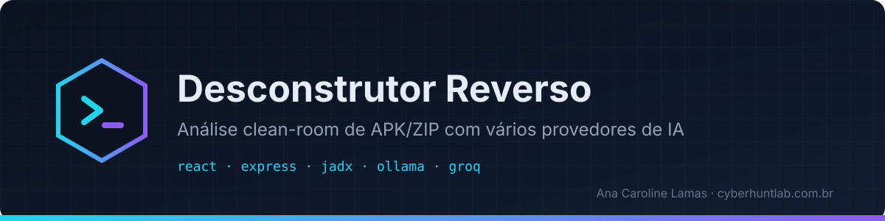

<p align="center"></p>

# Desconstrutor Reverso — análise clean-room de APK e ZIP com vários provedores de IA

Aplicação full-stack (**React + Vite** no front-end e **Express** no back-end) que faz **engenharia reversa clean-room** de pacotes **APK e ZIP**. O servidor extrai o pacote com **apktool** e **JADX**, reúne manifesto, estrutura e trechos de código, e envia esse resumo a um **modelo de linguagem à sua escolha** (Ollama, NVIDIA NIM, OpenAI, DeepSeek, Groq ou endpoint próprio). O modelo devolve um relatório de arquitetura e um **prompt mestre** para reimplementar o projeto de forma independente. A interface também publica arquivos no GitHub (ZipToGit).

> Mesmo código do [Descontrutor-Reverso](https://github.com/ticarollamas-arch/Descontrutor-Reverso), com o Ollama como provedor padrão.

## Recursos

- **Landing page** e páginas de Termos, Privacidade e Cookies; a ferramenta fica em `/app`.
- **Envio de pacotes** com árvore de arquivos, pré-visualização e seção dedicada a APK.
- **Análise real no servidor** (`POST /api/analyze-architecture`, upload multipart):
  - `apktool` decodifica recursos e manifesto (timeout de 60 s);
  - `JADX` descompila até 30 arquivos Java (512 MB de RAM, timeout de 120 s);
  - os arquivos temporários são apagados ao final.
- **Vários provedores de IA**: `ollama` (padrão, via Ollama Cloud com `gemma4:31b`), `nvidia`, `openai`, `deepseek`, `groq` ou `custom`; chave, URL e modelo podem vir do formulário ou do `.env`.
- **Relatório gerado por IA**: visão geral, stack, arquitetura, lógica passo a passo, prompt mestre e dicas de diferenciação visual, guiado pelo prompt de sistema em `src/prompts/carol-master.md`.
- **Publicação no GitHub** com token pessoal e pipeline de envio.
- **Proteções** contra *Zip Slip* e *zip bomb* no tratamento dos pacotes.

## Instalação

Requisitos: **Node.js 20+**, **apktool** e **JADX** no PATH (para análise de APK) e a chave de pelo menos um provedor de IA (ou um Ollama).

```bash
git clone https://github.com/ticarollamas-arch/projeto_carol-corrigido-ollama.git
cd projeto_carol-corrigido-ollama
npm install
cp .env.example .env
```

| Variável | Uso |
|---|---|
| `AI_PROVIDER` | Provedor padrão (`ollama`, `nvidia`, `openai`, `deepseek`, `groq`, `custom`) |
| `OLLAMA_BASE_URL`, `OLLAMA_API_KEY`, `OLLAMA_MODEL` | Ollama local ou Ollama Cloud |
| `NVIDIA_API_KEY`, `OPENAI_API_KEY`, `DEEPSEEK_API_KEY`, `GROQ_API_KEY`, `GEMINI_API_KEY` | Chaves dos demais provedores |
| `PORT` | Porta do servidor |

No Termux: `pkg install apktool` e instale o JADX manualmente; o limite de memória já foi pensado para celulares.

## Como usar

```bash
npm run dev        # servidor Express + Vite
npm run build      # build de produção
```

Abra `/app`, escolha o provedor, envie o APK ou ZIP e gere o relatório. Para publicar um pacote no GitHub, informe o token, o repositório e a branch.

## Estrutura

```
server.ts               API Express (upload + análise com o provedor escolhido)
backend-analyzer.ts     extração com apktool e JADX
src/                    front-end React (landing, app, páginas legais)
src/prompts/            prompts de sistema da análise
agent.py, fix-*.{py,cjs}, nuke-ui*.cjs, remove-api-ui.cjs
                        scripts de manutenção usados para ajustar interface e servidor
```

## Uso responsável

Analise apenas pacotes próprios ou com autorização do titular. A especificação gerada serve para uma implementação original: não copie código, marcas ou ativos de terceiros e não remova avisos de autoria ou licença.

## Tecnologias

TypeScript · React 19 · Vite · Tailwind CSS · Express · Multer · adm-zip · JSZip · apktool · JADX · Ollama · NVIDIA NIM · OpenAI · DeepSeek · Groq · GitHub REST API

## Licença

Distribuído sob a licença MIT. Veja [LICENSE](LICENSE).
